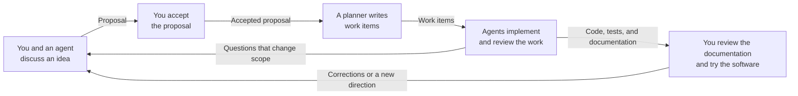

# seams

seams is a set of conventions and agent skills for building software with coding agents.
You put the conventions in your repository and install the skills in your agent harness.
You and your agents then invoke the skills when you discuss a feature, plan work, implement it, or review it.

seams isn't an application, an agent harness, or a work tracker.
No seams service runs in the background, and no skill acts until you or an agent invokes it.
You keep using your preferred coding agent, tracker, and review tools.

## Why use seams

A project that uses coding agents collects ideas, plans, notes, rules, task records, and summaries.
An agent can read an abandoned plan and an accepted rule without knowing which one should guide its work.
You can find the mistake only after the agent has built the wrong thing.

seams gives each kind of information a home and says what an agent may do with it.
The conventions also keep your decisions separate from the agent's working notes and from evidence about what the code actually does.

| Information                                     | Where it lives                                  | What an agent may do with it                                                              |
| :---------------------------------------------- | :---------------------------------------------- | :---------------------------------------------------------------------------------------- |
| Vision, principles, and invariants you accepted | Named files in `docs/design/`                   | Follow them. Only you can accept a change.                                                |
| Design overviews and user documentation         | `docs/design/overviews/` and your documentation | Use them to understand the system, and verify their claims against code and tests.        |
| Proposals, plans, notes, and work items         | `.agents/` and your tracker                     | Use them for the work they describe. A proposal authorizes work only after you accept it. |
| Code, tests, and the running system             | Your repository and running services            | Use them as evidence of what exists.                                                      |

The names **canon**, **memory**, and **reality** refer to these three kinds of information.
They aren't names of software components, and a project can use different file paths when its agent instructions name those paths.
Memory has no single shape or home, and keeping it clear takes deliberate maintenance.

## What using seams looks like

You start by discussing an idea with an agent.
For work that needs discussion, you run `/seams-propose` and decide what the proposal means.
You then run `/seams-plan` to turn the accepted proposal into tracked units of work, and `/seams-route` to send those units to agents.
Small, clear changes can go straight to an agent without a proposal or a detailed plan.

Each stage leaves information for the next stage.
A proposal carries your decisions into planning, and work items carry the plan into implementation.
Agents update design overviews and user documentation as the system changes.
Only you can accept changes to canon.

Especially in greenfield work, information flows from **proposals to plans to design overviews**.
The proposal holds the selected direction, and the plan organizes execution.
As agents implement the design, they move the lasting explanation into an overview.
The proposal and plan remain history, while the overview describes the current system.
Not every unit needs an overview.

Markdown files and tracker records carry information between stages and fresh agent sessions.
Agents read the records from earlier stages instead of relying on another agent's session memory.

The skills tell agents how to record decisions, ask you questions, continue work in a fresh session, and report what you can try.
Agents do the planning, implementation, and review.
You make the product decisions, accept changes to the project's rules, and judge whether the finished work matches what you wanted.

You don't need every convention or skill on the first day.
A new project can start with a short `AGENTS.md`, a few lines of vision, and a tracker.
The [guide](docs/guide.md) explains the stages, the information types, and the skills in more detail.

## Start here

| I want to                                | Read                                                                                                                                |
| :--------------------------------------- | :---------------------------------------------------------------------------------------------------------------------------------- |
| Understand how seams works               | [The guide](docs/guide.md)                                                                                                          |
| Start a project with the CLI             | Ask your agent to run `npx @grrrck/seams init`                                                                                      |
| Set up seams in a project                | [The guide's setup section](docs/guide.md#setting-up-seams-in-a-project) and the [`seams-adopt`](skills/seams-adopt/SKILL.md) skill |
| See which skills exist and who runs them | [The guide's skills section](docs/guide.md#the-skills)                                                                              |
| See the rules seams keeps                | [Vision](docs/design/vision.md), [principles](docs/design/principles.md), and [invariants](docs/design/invariants.md)               |
| Read what agents follow                  | [The skills](skills/)                                                                                                               |
| Know where the ideas come from           | [Supporting evidence](docs/supporting-evidence.md)                                                                                  |

## Install the skills and adopt the conventions

To start a project, ask your agent to run `npx @grrrck/seams init` in the project.
The command installs the seams skills for the agent harnesses it detects, then hands the rest of the setup to the `seams-adopt` skill.
The CLI is optional: every step also works with ordinary file edits.

Installing the skills and adopting the conventions are separate steps.
Without the CLI, copy or link the whole `skills/` folder into your agent harness's skill directory, because the skills refer to each other's files.
Then run `/seams-adopt` in your project to set up the conventions.
The skill reads your existing files and asks before moving or rewriting them.

## Work on seams itself

The canon for seams lives in [`docs/design/`](docs/design/index.md), its proposals live in `.agents/proposals/`, and its work is tracked in kata.
The [`AGENTS.md`](AGENTS.md) file is the entry point for agents working on seams itself.

Use the parts that fit your project.
