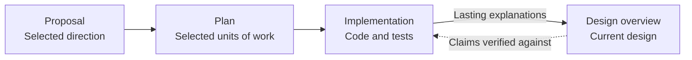

# Design overviews

Design overviews explain how the current system fits together and why its difficult parts work that
way. They give maintainers and fresh agent sessions an understanding that would be slow to rebuild
from code, tests, and old work records. They also give the operator something useful to read when
judging whether the finished system matches their intent.

An overview is maintained memory, not canon. It has descriptive weight when a reader wants to
understand the current design, but it does not authorize work or override the operator's accepted
direction. Code, tests, and runtime evidence establish what exists. An overview guides readers to
that reality through exact references; it never replaces the need to check them.

## Design overviews serve fresh readers and operator review

A useful collection of design overviews lets a reader start with a small map, choose the documents
relevant to a task, and understand the important parts without loading the whole project's history.
It should help people and agents:

- find the responsibility of a system or subsystem and see its important connections;
- understand runtime behavior that crosses component boundaries;
- recover constraints, standing cautions, and reasoning that code alone does not make clear;
- notice when the implementation and its description disagree;
- review awkward connections and unexpected complexity at a level above individual code changes;
- continue work in a fresh session without relying on another agent's memory.

The operator can read an overview and try the software before deciding whether the design needs to
change. Agent checks can show that the description agrees with the code at a particular revision.
Only the operator can judge whether that design is what they want.

## How overviews fit into seams

Canon records the accepted direction, and proposals, plans, and work items record the execution
history. Overviews explain the current system to maintainers, while user documentation explains how
to use the software. Code, tests, and runtime evidence establish reality. The
[guide](../../guide.md#canon-memory-and-reality) explains the wider information model, including why
memory has many homes and needs deliberate maintenance.

## Create an overview when the design is hard to recover

Create an overview when a system or subsystem has connections, constraints, or reasoning that a
reader cannot recover cheaply from code and user documentation. A difficult subsystem may need its
own document. A small feature usually does not.

Do not create an overview for every file, feature, proposal, or unit of work. A project does not
need a fixed set of documents on its first day. The collection should grow when real design needs
explanation, not because a template has empty sections to fill.

An existing useful documentation home wins over a new default. A project may already call these
documents architecture notes, design memory, or something else. Keep that home and record it in
`AGENTS.md` rather than moving documents merely to match a seams filename.

## A good overview explains responsibility, connections, and reasoning

A good overview starts with its audience and scope. It says what it explains, what it leaves to
code, tests, user documentation, or work records, and which code and tests support its main claims.
It does not open with narration about the document itself.

Include the parts a maintainer needs to understand the current design:

- the system's or subsystem's responsibility;
- its important connections and the reasons for difficult boundaries;
- relevant runtime behavior and interaction scenarios;
- exact file and symbol references that let a reader verify the explanation;
- standing cautions and constraints that are easy to miss;
- a past decision or rejected alternative when it explains why the current design has this shape;
- deployment details or terminology only when readers need them.

A past decision belongs in an overview only as explanation of the present. Link to the proposal or
canon that holds the decision rather than turning the overview into a decision log. Keep interface
contracts in code, quality requirements in canon or tests, and volatile risks, debt estimates, task
status, and execution history in work records.

There is no required template. Design overviews borrow content ideas from architecture practices,
such as system context, building blocks, runtime flows, and cross-cutting concepts, without adopting
formal section names. Choose only the sections that help the intended reader.

Rules, contracts, and status each need one owning home. An overview may repeat enough context to
show how parts relate and to make the document understandable on its own. Link to the owning
document for the full rule or contract instead of forcing every explanation into isolated fragments.

## A flat collection with descriptive names supports discovery

The default home is `docs/design/overviews/`. This keeps maintained memory beside the design canon
while preserving a physical boundary between them. The named canon files live directly under
`docs/design/`; the overviews live in their nested folder. The design index provides navigation and
does not create rules of its own.

```text
docs/design/
  index.md
  vision.md
  principles.md
  invariants.md
  invariants/<topic>.md
  overviews/
    index.md
    <system-or-subsystem>.md
    concept_<topic-slug>.md
    flow_<flow-slug>.md
```

Use a descriptive filename for a system or subsystem overview. Most concepts and flows belong as
sections inside the subsystem overview that owns them. A standalone document is useful when an
explanation crosses subsystem boundaries or several overviews need to link to it.

The optional `concept_` and `flow_` prefixes make those special cases visible in directory listings
and shell searches. For example, an agent can select flow documents with a filename glob. The
prefixes do not create required document types, and ordinary overviews remain unprefixed. The
default collection is flat so files are easy to list and search, but a project can choose another
structure when its conventions call for one.

When repo-level `docs/` is unavailable because of package builds, generated sites, or other project
conventions, the fallback design root is `.agents/design/`. It uses the same canon files and
`overviews/` folder. The files must be tracked and discoverable through `AGENTS.md`.

The index should say when to read each document so an agent can select relevant material instead of
loading the whole collection. Reading the index is preparation, not a substitute for reading the
relevant overview. Add a catalog script, a large frontmatter schema, or other navigation tooling
only when a simple index is no longer enough.

## Overviews absorb lasting explanations as implementation proceeds

In greenfield work, information usually flows from **proposal to plan to design overview**:



The proposal holds the selected direction. The plan organizes the work. As agents implement the
design, they move the lasting explanation into the owning overview. The proposal and plan remain
history; the overview changes in place to describe the present.

Do not copy a plan wholesale into an overview. Keep only what a maintainer needs after the work is
done. Agents can draft documentation for a new feature after its behavior becomes stable, but they
must complete it before that work closes.

Existing behavior needs the same care. A change updates the documents that already describe the
affected behavior or structure in the same body of work. A small direct change does not need a
proposal merely to maintain its documentation. If work reveals that an overview is stale or
incomplete, correct the overview rather than leaving the only correction in a plan or work item.

Write the current explanation instead of appending a narrative of the latest change. Add lasting
rationale and active exceptions to the relevant section. Keep temporary hypotheses, execution
checklists, progress, and hand-offs in working records.

## Review checks both grounding and intent

A fresh agent starts with the index, reads the overviews that match its task, and follows their code
references and tests when current behavior matters. An overview is a guide to reality, not proof of
it. Important contradictions between documentation and code need to be reported and corrected, not
silently resolved in favor of whichever text the agent happened to read first.

Documentation changes appear alongside the implementation in review. Agents verify claims, code
references, and links, and call out new cautions, unexpected complexity, and departures from the
previous description. The operator reads the relevant documentation and tries the software. Their
corrections can lead to a documentation fix, an implementation change, or a proposed canon change.
Only the operator accepts canon changes.

Over time, reconciliation checks for stale, duplicated, contradictory, and unused documents. It also
looks for lasting explanations left behind in finished proposals and plans. Superseded material can
remain as history outside normal navigation, but old plans should not compete with maintained
overviews as descriptions of the present.

## Existing skills carry documentation through the work

The existing skills share the documentation work. seams does not need a separate documentation or
memory skill. The common agent procedure lives in
[`seams-work/references/documentation.md`](../../../skills/seams-work/references/documentation.md),
and the other skills point to it rather than maintaining separate versions.

| Skill                                                         | Support for design overviews                                                                                                                                                                        |
| :------------------------------------------------------------ | :-------------------------------------------------------------------------------------------------------------------------------------------------------------------------------------------------- |
| [`seams-adopt`](../../../skills/seams-adopt/SKILL.md)         | Inventories existing documentation, preserves useful homes, chooses a compatible design root, and seeds the indexes. It does not turn old descriptions into canon.                                  |
| [`seams-propose`](../../../skills/seams-propose/SKILL.md)     | Reads the affected documents and records which documentation the selected work should update, including whether a new overview is expected. A planned overview is not yet a description of reality. |
| [`seams-plan`](../../../skills/seams-plan/SKILL.md)           | Carries the affected documents into unit bodies and verification criteria so each implementer receives the documentation responsibility with the work.                                              |
| [`seams-work`](../../../skills/seams-work/SKILL.md)           | Helps agents discover, create, maintain, and verify overviews in the same unit as the implementation.                                                                                               |
| [`seams-route`](../../../skills/seams-route/SKILL.md)         | Passes affected documents to implementers and reviewers, checks documentation reports, and includes documentation in unit and final review.                                                         |
| [`seams-reconcile`](../../../skills/seams-reconcile/SKILL.md) | Finds documentation drift and unnecessary growth, and proposes corrections to the owning documents.                                                                                                 |
| [`seams-orient`](../../../skills/seams-orient/SKILL.md)       | Helps agents write for a reader and present documentation to the operator in a form that supports review and decisions.                                                                             |

These skills make documentation part of development rather than a separate cleanup step after the
context has been lost. They also keep its role clear: overviews preserve understanding, working
records preserve execution, canon preserves accepted intent, and reality remains in code, tests, and
runtime evidence.
