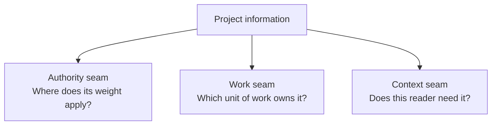
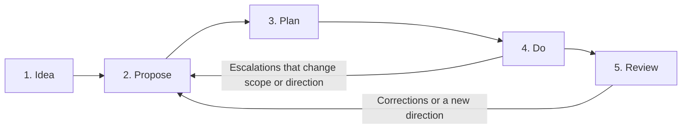

# How seams works

Operators decide what to build and work with coding agents. seams helps you sort the project's information, invoke skills at each stage of work, and review the result.
The [design docs](design/index.md) contain the rules, and the [skills](../skills/) contain the procedures that agents follow.

## The problem seams addresses

A project that uses coding agents collects ideas, plans, notes, rules, task records, and summaries.
An agent reads all of it, and it can't tell which text you still stand behind.
A plan you dropped last month can steer today's work as easily as a rule you rely on.
You can't read all of it either, so you often find the misreading late, when you review code that went in the wrong direction.

seams handles the problem with these conventions:

- It gives each statement a type and a home, so agents can tell what binds them.
- It moves your effort to the start of the work, where you and an agent agree on what to build.
- It hands work between agents only through files and the tracker, so no agent depends on another agent's memory.
- It gives you documentation and working software to review after implementation, so you can check the result without rebuilding the whole design from the code.

## Authority and grounding

Agents need to know how much weight a statement carries in their context and whether the code supports what the statement says. seams calls these properties authority and grounding.
The physical separation of canon, memory, and code makes both properties easier to see.

### Authority says how much weight a statement carries

**Authority** is the weight a statement carries in a particular context.
There is no single ranking that answers every question.
Canon carries the most weight for intent and constraints.
An accepted proposal and its work items carry more weight for an implementer working within the selected scope.
Code, tests, and runtime evidence carry the most weight for what exists.

A vision defines the system's overall shape, which features fit, and the criteria for judging their value and priority.
It writes down judgment you would otherwise have to supply each time an agent assesses a feature.
Principles record your standing preferences for decisions along the path from idea to implementation, such as structure, tools, errors, compatibility, and feature breadth or depth.
Invariants bind every stage.

Permission to act is a separate question from authority.
An accepted proposal authorizes the work it describes.
A note or a draft authorizes nothing.
A detailed plan in `.agents/plans/` doesn't become binding because it is well written, and an old proposal doesn't become active because an agent finds it useful.
Only you can accept a proposal or a change to canon.

### Grounding says what the code supports

**Grounding** is how much the code and tests back the statement.
A statement can be planned, applied, or enforced:

- **Planned** means that nothing follows the statement yet.
- **Applied** means that some decisions or code follow it.
- **Enforced** means that a test or a lint checks it.

Grounding changes as the project changes.
A principle you wrote on the first day is an aspiration.
After a dozen decisions have followed it, the same principle is harder to set aside.
An invariant that the code doesn't follow yet is marked **Planned**, so agents treat it as a rule for new work and not as a description of the current code.

One way to raise grounding is to link each invariant to the files it governs.
Each governed file starts with a line that names its invariant, and a lint checks the links in both directions.
An agent that opens the file then finds the rule at the moment it needs it.

## How seams sorts information

### Canon, memory, and reality

For statements, authority and grounding decide which group the statement belongs to.
Code, tests, and runtime evidence form reality.
Each group has a physical home, so an agent can often tell how to treat a statement before reading it.

| Group   | Home                                                                      | Meaning                                                                                                 |
| :------ | :------------------------------------------------------------------------ | :------------------------------------------------------------------------------------------------------ |
| Canon   | Named files in `docs/design/`, with an optional `invariants/` folder      | The vision, principles, and invariants you accepted. Only you accept changes to canon.                  |
| Memory  | `.agents/`, the tracker, `docs/design/overviews/`, and user documentation | Working records and maintained explanations that agents use to continue work and understand the system. |
| Reality | The repository and running system                                         | The code, tests, and runtime evidence that show what exists.                                            |

Memory has no single form, owner, or location.
A project's memory includes proposals, plans, work items, design overviews, user documentation, and other records. seams can't put all memory in one place.
It can help you find the records, assess their value, and direct agents to maintain them as the system evolves.

A project may also keep local working notes for short-lived experiments, research, and background.
Notes are the lowest-weight memory.
They authorize nothing, stay uncommitted by default, and stay out of general listings and searches until you ask for them.
Adoption looks for your existing notes convention, suggests `_dev/notes/` when there is none, and you confirm the home before anything is recorded.

Maintaining memory takes deliberate effort.
Without maintenance, it becomes unclear or confusing.
Memory never becomes canon just because it persists, is detailed, or is recent.
Documentation and summaries can describe the current system, but only code, tests, and runtime evidence establish what exists.

Especially in greenfield work, information flows from **proposals to plans to design overviews**.
The proposal holds the selected direction, and the plan organizes execution.
As agents implement the design, they move the lasting explanation into the owning design overview.
The proposal and plan remain history, while the overview describes the current system.
Not every proposal or unit needs an overview.

Drift is a change in the project's direction that you never accepted.
It happens when memory starts to act like canon.
For example, an agent reads a detailed draft plan and builds it, because nothing told it the plan was never accepted.
The [invariants](design/invariants.md) prevent drift by giving each kind of statement one home and by saying where its weight applies.

### Kinds of seams

A seam is a boundary in the project's information, and seams takes its name from these boundaries.
Each kind of seam answers a different question about the same information:

- **Authority seams** separate statements by type.
  They answer, "What kind of claim does this statement make, and how much weight does it carry in this context?"
- **Work seams** separate statements by scope.
  They answer, "Which unit of work does this statement belong to?"
- **Context seams** separate readers from information they don't need.
  They answer, "Which statements should this reader receive when it starts work?"



At a context seam, each reader gets the statements its role and task need, and nothing else.
An implementer gets its work item, the canon that governs it, and the code.
It doesn't get draft proposals.
A reviewer gets the work item, the canon, and the change.
It doesn't get the implementer's notes, so its review stays independent.

## The skills

The conventions become a workflow when you or an agent invokes a skill.
A skill is a procedure that the coding agent loads at a particular moment.
It isn't a program that runs on its own.

You run these skills yourself:

| Skill             | Use it to                                                                                 |
| :---------------- | :---------------------------------------------------------------------------------------- |
| `seams-adopt`     | Set up seams and its documentation homes, or move an existing project to it.              |
| `seams-propose`   | Write a proposal, identify affected documentation, and move accepted rules into canon.    |
| `seams-plan`      | Turn a proposal into tracked units, including the documentation each unit affects.        |
| `seams-route`     | Send units to agents, review their implementation and documentation, and land them.       |
| `seams-reconcile` | Find drift in canon, documentation, memory, and code, and turn decisions into principles. |

Agents load these skills on their own when a situation calls for them:

| Skill          | Agents use it to                                                       |
| :------------- | :--------------------------------------------------------------------- |
| `seams-work`   | Carry out one unit, maintain its documentation, and record questions.  |
| `seams-shape`  | Split, sequence, and hand out work.                                    |
| `seams-orient` | Explain something to you or ask you a question you can answer quickly. |
| `seams-track`  | Read and write the project's tracker.                                  |

Install the skills together, because some of them refer to each other's files.
Installing the skills doesn't change a project.
You adopt the conventions separately by running `seams-adopt`.

## From an idea to reviewed work

Work moves through the stages in the table below.
Most of your effort goes into the first two stages and the final review.
During implementation, you answer the questions only you can answer.

| Stage      | Who              | What happens                                                                                                                                     | You run                    |
| :--------- | :--------------- | :----------------------------------------------------------------------------------------------------------------------------------------------- | :------------------------- |
| 1. Idea    | You              | You say "we should do X".                                                                                                                        |                            |
| 2. Propose | You and an agent | You decide together what X means. You accept, reject, defer, or withdraw the proposal.                                                           | `/seams-propose <idea>`    |
| 3. Plan    | An agent         | The planner turns the accepted proposal into units of work in the tracker. You confirm its outline and read-back.                                | `/seams-plan <proposal>`   |
| 4. Do      | Agents           | A router sends each unit to an agent, gets it reviewed, and lands it on an integration branch.                                                   | `/seams-route <root item>` |
| 5. Review  | You and agents   | Agents verify the documentation and the change. You read the documentation, try the software, and decide whether the result matches your intent. |                            |



A small, clear change doesn't need stages 2 and 3.
A direct request from you, e.g., "rename this function" or "fix this failing test", authorizes that change, and an agent handles it with `seams-work`.
The work still gets a record in the tracker, and the agent asks you directly if it encounters a question canon doesn't answer.
You still review the result.

### Stage 2: Propose

A proposal is a short document in `.agents/proposals/` that you write with an agent.
It records the question, the options you looked at, what you agreed, what you set aside, and what is still open.
Every proposal ends with one of these statuses:

- **Accepted** means the work is selected.
  The durable parts, e.g., new principles or invariants, move into canon, and the proposal becomes history.
- **Rejected** means you decided against it.
  If the reason applies beyond this proposal, it becomes a principle.
- **Deferred** means you have decided not to do the work now.
  The proposal stays in memory and authorizes nothing.
- **Withdrawn** means the proposal is no longer relevant.

The later stages can run without you only if the proposal and canon answer the questions agents will encounter.
Principles do most of this work, because a principle can answer a question nobody thought of when it was written.

### Stage 3: Plan

The planner breaks the accepted proposal into units of work, in layers of increasing detail, a method known as stepwise refinement.
Each unit goes into the tracker with its scope, what it must prove, and what it depends on.
A unit is ready only when no consequential decision is left for the implementer to make silently.
A consequential decision is one about product behavior, persistent data, public interfaces, safety, or acceptance.

A plan document records its status in its frontmatter, and the status takes four values. `draft` means the planner has written the plan and you have not yet confirmed its outline and read-back.
A draft authorizes nothing, and search tools that skip drafts will not find it. `active` means you confirmed the plan, and the planner sets it. `done` means every unit in the plan has landed, and when the plan document is the tracker, a closing unit in the plan sets it. `abandoned` means you dropped the work or the plan was replaced, and the planner sets it and says why in the plan body.

You don't need to read the units.
Before creating them, the planner shows you a short outline and a **read-back**.
A read-back says, in your terms, what the implementers will build, what they may not do, and when they will stop and ask.
You confirm the read-back, or correct it, before any unit is created.
The practice of restating an instruction before acting on it is called read-back, or closed-loop communication, in aviation and team research.

The plan sequences the work so that you can use something early.
The first unit to land is usually the smallest interface that exercises the core behavior, e.g., a command line tool, and later units build a web UI or other interfaces on top of it.
If you want to change direction after trying it, little has been built yet.

### Stage 4: Do

A router chooses an agent of a suitable size for each ready unit.
Each agent works in its own branch and worktree.
Each unit is reviewed independently and landed one at a time.
The tracker holds the state of every unit, so a fresh router can resume a run that another router started.

Questions and corrections often arise during implementation.
The agent records them on the work item, and the answer becomes part of the work rather than disappearing into a conversation.

An escalation returns to stage 2 when it changes the selected scope or direction.
You and an agent revise the proposal or write a new one, and the planner updates the affected work items after you accept the change.
An answer within the existing scope stays on the work item, and implementation continues.

Agents maintain the user documentation and design overviews affected by each unit in the same body of work.
Agents can draft a new feature's documentation after its behavior becomes stable, but they must complete it before the work closes.
A change to existing behavior or structure updates the documents that already describe it.

A design overview explains how the current system fits together and why difficult parts work that way.
It gives a maintainer exact references to the supporting code and tests.
It doesn't contain task status, execution checklists, or a narrative of the latest change.
Most concepts and flows belong inside their owning subsystem overview.
A standalone cross-cutting document can use a `concept_` or `flow_` filename prefix in the same flat `overviews/` folder.

### Stage 5: Review

Review gives you a way to understand what the agents built and to bring the result back in line with your intent.
Agents can check documentation against the code, run the tests, and verify specific claims.
You can then read the documentation and try the software instead of reconstructing the whole system from its implementation.

Documentation is useful review material because it presents the system at a higher level than the code.
A guide, a design overview, or a help page can reveal a mismatch between your mental model and the software, an awkward connection between components, or a warning that points to a design problem.
After you understand the system, you may still choose to review the code for correctness or style.

Agent checks can show that documentation agrees with the code at a particular revision.
They don't show that the design is what you want.
Your review supplies that judgment.
Corrections can become a new work item, a proposal, or a proposed change to canon, depending on what needs to change.

When the work is ready, the agent gives you something to try, e.g., "the command now does X, run it like this", and not only a summary to read.
You decide when to merge the result.

## Questions during the work

When an agent encounters a consequential question, it first checks canon.
If canon answers the question, the agent follows canon.
If not, the agent records the question on the work item and stops the affected part of the work.
The planner or the router picks the question up and either answers it from canon or passes it to you as a decision you can make, with the options and a recommendation.

Some questions have to reach you, because nobody can foresee every problem.
For example, a change can break an unrelated test, or the code can turn out to rely on an assumption nobody wrote down.
Other questions are avoidable, because canon held the answer or should have held it.
After you answer a question, the agent asks whether canon could have answered it.
If it could have, the agent proposes the principle, non-goal, or invariant that would have answered it.
The aim is that fewer avoidable questions reach you over time.

Every answer is recorded on the work item.
A one-off answer stays there.
An answer that changes canon becomes a proposed canon change, and after you accept it, it reaches canon in one of these ways:

- If the change stands on its own, it is merged right away, even if the work that raised it is still in progress.
- If the change is tied to the implementation, it is merged when that implementation is merged.

## How agents coordinate

Agents don't remember earlier sessions, and they don't talk to each other directly in seams.
They coordinate through the traces they leave in shared places: the tracker, the repository, and commits.
One agent can leave a question on a work item, a second agent can answer it, and a third agent can use the answer.
The research term for this kind of coordination is stigmergy.

The tracker is the agents' working surface.
Canon holds the accepted direction, and documentation holds maintained explanations.
Any tracker works if agents can read and write it from the command line.
The `seams-track` skill has notes for kata, GitHub issues, Markdown files, and other trackers.

## The optional command line tool

seams ships an optional command line tool, the npm package `@grrrck/seams`.
An agent uses it to find and read the project's documents without loading all of them, and to install the skills.
The conventions do not require it: every step in seams also works with ordinary file edits.

A project records where its documents live in a manifest, the file `.agents/seams.json` that `seams-adopt` writes after you choose the documentation homes.
The manifest records the home of each document type: canon, design overviews, proposals, and plans.
The manifest also takes an optional `notes` entry for the local notes home.
When the entry or the whole manifest is absent, the tool still discovers an existing `_dev/notes/` on its own, and it never creates the folder: a project without notes simply has none, and a missing notes home produces no warning.
When the manifest is absent, the tool looks in the conventional layout instead: `docs/design/` for canon and design overviews, and `.agents/proposals/` and `.agents/plans/` for proposals and plans.
A project with a custom home always needs the manifest, because otherwise the tool looks in the default places.

The reading commands help an agent start work without reading everything:

| Command                         | What it shows                                                                                                   |
| :------------------------------ | :-------------------------------------------------------------------------------------------------------------- |
| `seams list`                    | The documents in the documentation homes, one line each with its path, title, size, authority, and description. |
| `seams find "<text>"`           | The places the text appears, with a short excerpt and the document and heading around it.                       |
| `seams read <document>`         | A whole document, one section with `--section <heading>`, or a line range with `--lines <a-b>`.                 |
| `seams read outline <document>` | The document's headings with their line ranges and sizes, so the agent can choose what to read.                 |

General `seams list` and `seams find` omit notes, so an ordinary documentation read does not surface them.
Notes appear only when the caller asks for them: `seams list --type notes` lists them, `seams find "<text>" --type notes` searches them, and `seams read` opens one by its path.

The examples write the command as `seams`.
When the tool is not installed as a command, run the same commands through npx, e.g., `npx @grrrck/seams list`.
The README describes how to install the skills and start a project with the CLI.

## Setting up seams in a project

The `seams-adopt` skill sets up a new project or moves an existing one to seams.
A project that uses seams usually has this layout:

```text
AGENTS.md            where things live, which tracker to use, how to run checks
docs/design/
  index.md           navigation for canon and overviews
  vision.md          purpose, users, outcomes, and non-goals
  principles.md      the operator's standing preferences for decisions
  invariants.md      rules that must hold
  invariants/        optional canon files split by topic
  overviews/         maintained memory about the current design
    index.md
    <system-or-subsystem>.md
    concept_<topic-slug>.md  optional standalone concept
    flow_<flow-slug>.md      optional standalone flow
.agents/proposals/   proposals
.agents/plans/       plans
_dev/notes/          local working notes, uncommitted by default
.agents/seams.json   the manifest that records where each document type lives
<tracker>            work items, e.g., kata, GitHub issues, or Markdown files
```

Keep a useful existing documentation home when the project already has one.
Otherwise, use `docs/design/` when it works with the project's package builds and generated sites.
When repo-level `docs/` is unavailable, use `.agents/design/` with the same structure, make sure Git tracks it, and record the location in `AGENTS.md`.

Start small. A new project needs a short `AGENTS.md`, a few lines of vision, and a tracker.
Add principles and invariants when real decisions produce them.
Create individual design overviews when the system has connections, constraints, or reasoning that code and user documentation can't explain cheaply on their own.

## Where the ideas come from

Each idea in seams comes from an older field, e.g., software architecture, human factors, organization theory, or lean product development.
The [supporting evidence](supporting-evidence.md) names the source of each idea and says where the comparison to agent-assisted coding stops.
